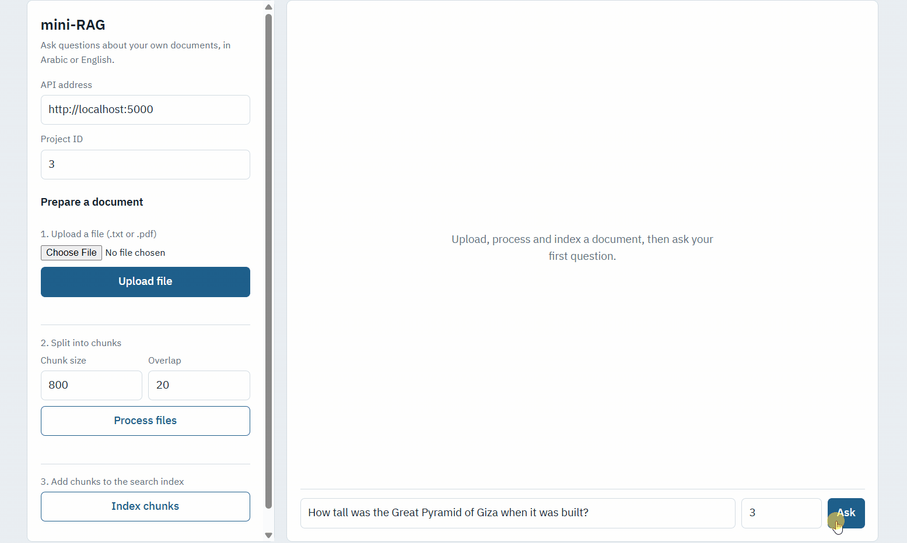
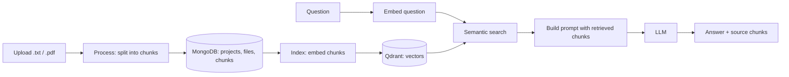
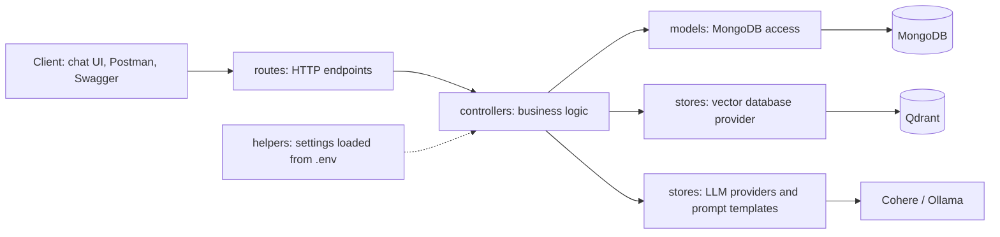
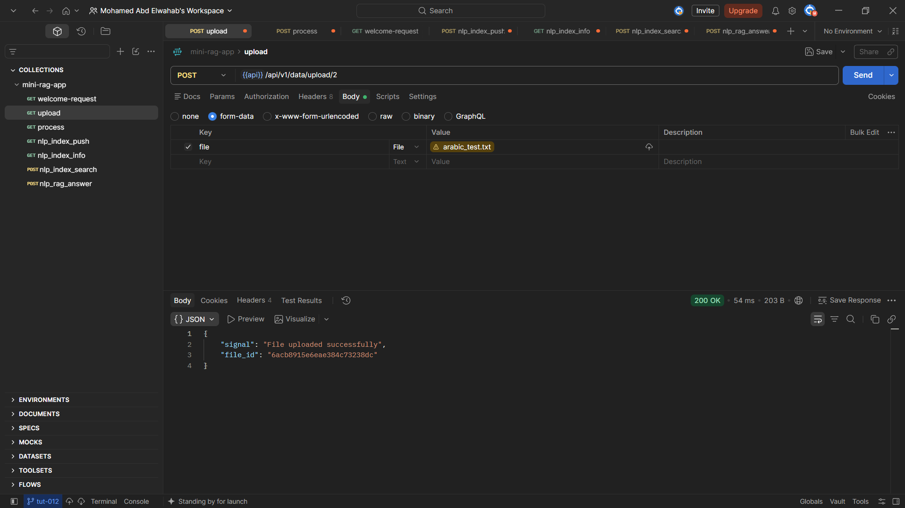
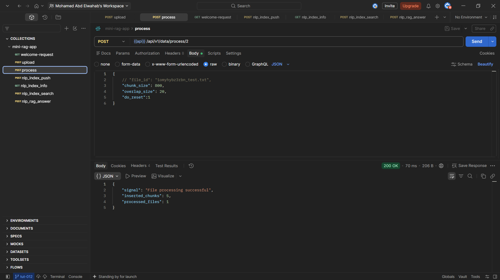
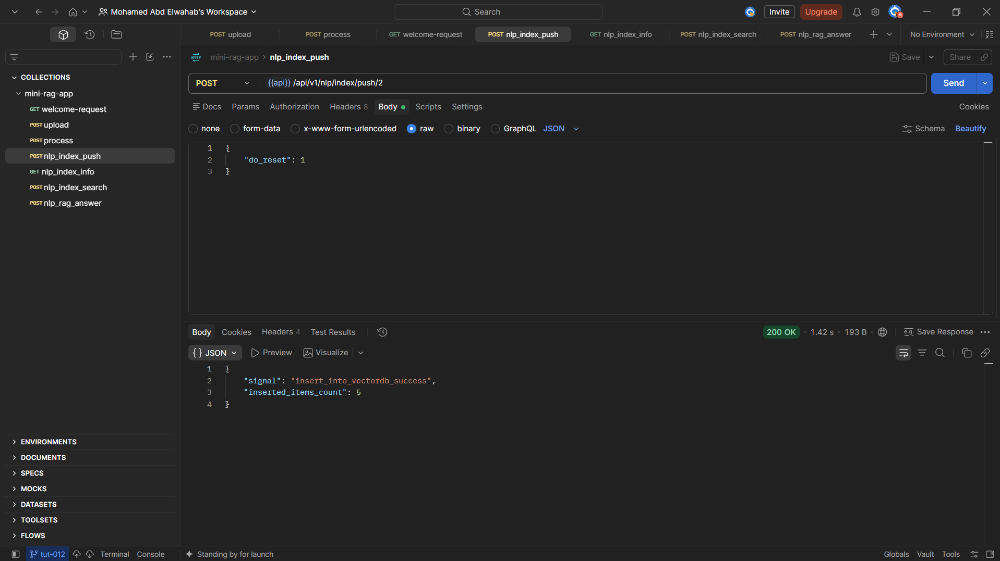
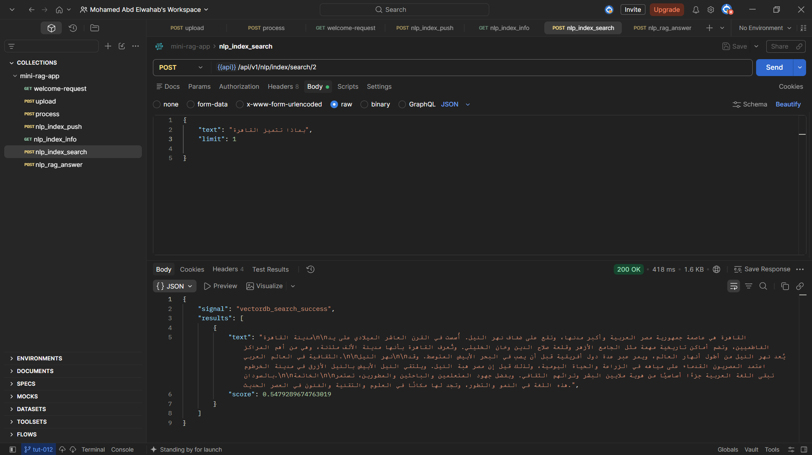
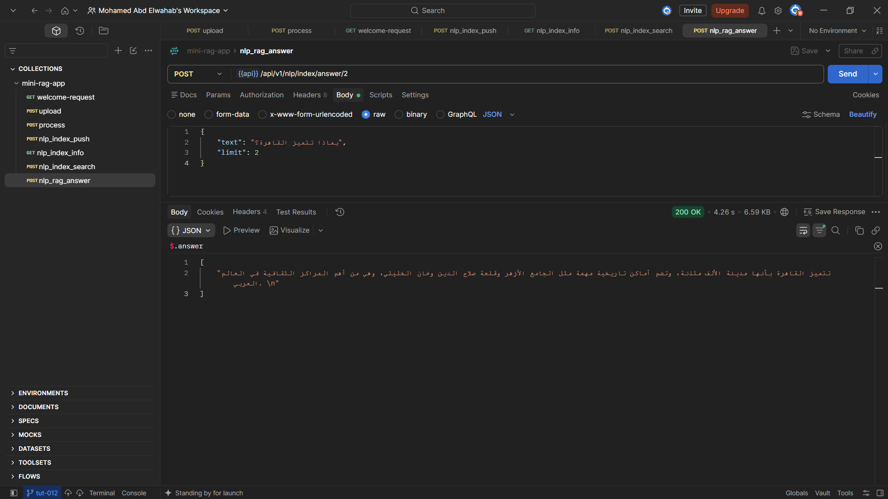
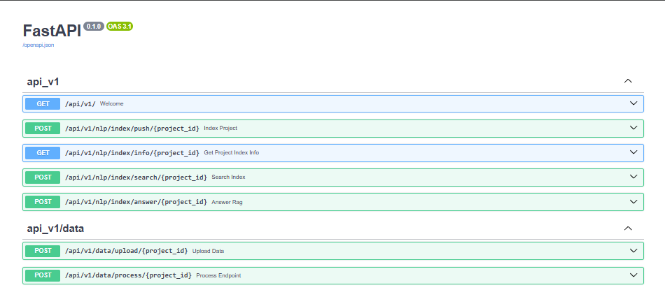

# mini-RAG
 
A retrieval-augmented question answering API built with FastAPI. Upload a document, split it into chunks, index it in a vector database, then ask questions and get answers grounded in your own text. It works with **Arabic and English** documents.
 

 
## What it does
 
- Uploads `.txt` and `.pdf` files and splits them into overlapping chunks (size and overlap are configurable per request).
- Stores projects, files and chunks in MongoDB.
- Embeds chunks with a multilingual embedding model and stores the vectors in Qdrant.
- Finds the most relevant chunks for a question with semantic search (cosine similarity).
- Builds a prompt from the retrieved chunks and asks an LLM for an answer.
- Includes a small browser chat UI that shows each answer together with the source chunks and their similarity scores.
## How it works
 

 
The LLM and embedding providers sit behind a factory, so switching between providers is a configuration change, not a code change.
 
## Code structure
 
Every request travels through the same layers:
 

 
The repo also contains `docker/` (MongoDB service), `postman/` (request collection), `ui/` (chat page), `samples/` (test documents) and `docs/` (demo GIF and screenshots).
 
## Tech stack
 
| Part | Technology |
|---|---|
| API | FastAPI, Uvicorn |
| Database | MongoDB (via Motor), run with Docker |
| Vector database | Qdrant (local storage) |
| Embeddings | Cohere multilingual embeddings |
| Generation | Ollama served from Google Colab through ngrok, or Cohere |
| Testing | Postman collection, Swagger UI at `/docs` |
 
## Screenshots
 
| Upload | Process |
|---|---|
|  |  |
 
| Index | Search |
|---|---|
|  |  |
 
| Answer | API endpoints |
|---|---|
|  |  |
 
## Quick start
 
### Requirements
 
- Python 3.11
- Docker (for MongoDB)
- A Cohere API key (a free trial key works)
- Optional: a Google account for the Colab notebook, and an ngrok account
- Python packages, installed in step 1 from `src/Requirements.txt`:
  - **API:** FastAPI, Uvicorn, python-multipart, python-dotenv, pydantic-settings, aiofiles
  - **Documents:** PyMuPDF (PDF reading), LangChain (text splitting)
  - **Databases:** Motor and PyMongo (MongoDB), qdrant-client (Qdrant)
  - **LLM clients:** Cohere, and the OpenAI client (used to talk to the Ollama server)
  - **HTTP:** httpx, pinned to 0.27.2 to avoid a `proxies` error with the OpenAI client
### 1. Create the environment
 
```bash
conda create -n mini-rag-app python=3.11
conda activate mini-rag-app
pip install -r src/Requirements.txt
```
 
### 2. Configure environment variables
 
```bash
cp src/.env.example src/.env
```
 
Open `src/.env` and fill in your values. All variables are listed in `src/.env.example`. Never commit `.env`.
 
### 3. Start MongoDB
 
```bash
cd docker
cp .env.example .env     # then edit it with your credentials
docker compose up -d
```
 
### 4. (Optional) Run a local LLM with Ollama on Colab
 
Use this if you want generation without a paid API.
 
1. Open the [Colab notebook](https://colab.research.google.com/drive/1d2AVx7rBh0U3UnDTQjLaW-62y1iuvIkb?usp=sharing) and choose **File, Save a copy in Drive**, so you can edit it.
2. Create a free ngrok account and copy your **auth token**.
3. In Colab, open the **Secrets** panel (key icon), add the token as a secret, and allow the notebook to access it.
4. Run all cells. The notebook prints a public **ngrok URL**.
5. Copy that URL into `src/.env` as the address of the generation server, and save the file.
The URL changes every session, so repeat steps 4 and 5 each time you restart the notebook.
 
### 5. Run the server
 
```bash
cd src
uvicorn main:app --reload --host 0.0.0.0 --port 5000
```
 
Open `http://localhost:5000/docs` to explore the API. Restart the server after editing `.env`, because it reads the file only at startup.
 
### 6. Try the chat UI
 
Open `ui/mini-rag-ui.html` in your browser, then:
 
1. Pick a file (try `samples/english_test.txt` or `samples/arabic_test.txt`) and click **Upload file**.
2. Click **Process files**, then **Index chunks**.
3. Ask a question, or click one of the sample questions.
4. Open **Sources** under an answer to see the retrieved chunks and their similarity scores.
The server enables CORS so the page can call the API. Restrict `allow_origins` in `src/main.py` before deploying anywhere public.
 
## API
 
All routes are under `/api/v1`. `project_id` is any integer that groups your files.
 
| Method | Route | Body | Purpose |
|---|---|---|---|
| GET | `/` | none | Welcome and version |
| POST | `/data/upload/{project_id}` | multipart `file` | Upload a document |
| POST | `/data/process/{project_id}` | `chunk_size`, `overlap_size`, `do_reset` | Split files into chunks |
| POST | `/nlp/index/push/{project_id}` | `do_reset` | Embed chunks and store the vectors |
| GET | `/nlp/index/info/{project_id}` | none | Vector collection info |
| POST | `/nlp/index/search/{project_id}` | `text`, `limit` | Semantic search |
| POST | `/nlp/index/answer/{project_id}` | `text`, `limit` | RAG answer |
 
A Postman collection for every route is in the `postman/` folder.
 
## Limitations and lessons
 
- **The number of retrieved chunks (Sources) matters.** In the Arabic test, retrieving 3 chunks added unrelated text, and the small model answered from it instead of from the Cairo chunk, even though search had ranked the Cairo chunk first. Lowering the number to 1 can help in similar cases. It can also hurt: a single chunk may miss an answer that sits elsewhere, so tune it per kind of question.
- **Answer quality depends on the generation model.** A small LLM can copy the markdown headers from the prompt into its answer. The UI strips those headers for display only.
- **Chunk size matters.** With 800-character chunks, one chunk can mix several topics, which blurs its embedding. Smaller chunks give sharper retrieval.
- Uploading the same file twice stores two copies, and both are processed.
## Credits
 
Built while following the **mini-RAG: From notebooks to the PRODUCTION** course by [Abu Bakr Soliman](https://www.youtube.com/@bakrianoo) ([playlist](https://www.youtube.com/playlist?list=PLvLvlVqNQGHCUR2p0b8a0QpVjDUg50wQj)). The original code is at [bakrianoo/mini-rag](https://github.com/bakrianoo/mini-rag).
 
## License
 
See [LICENSE](LICENSE).
 